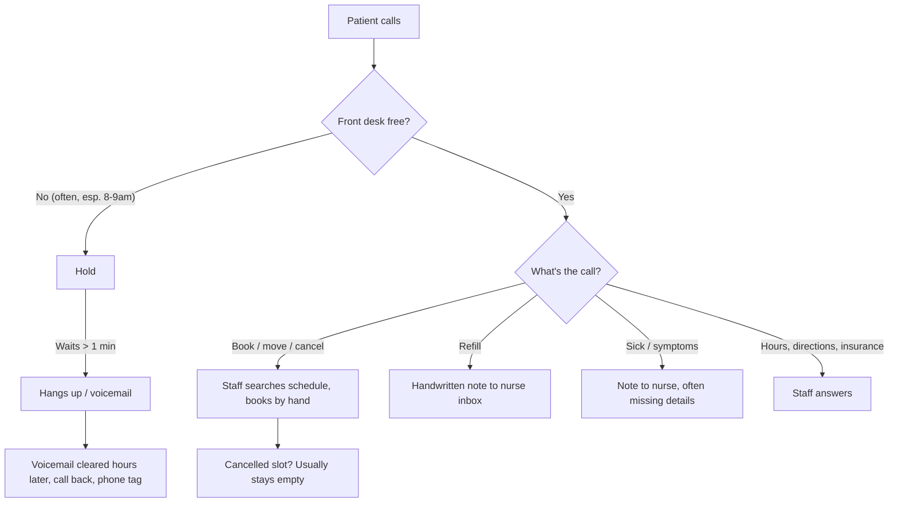
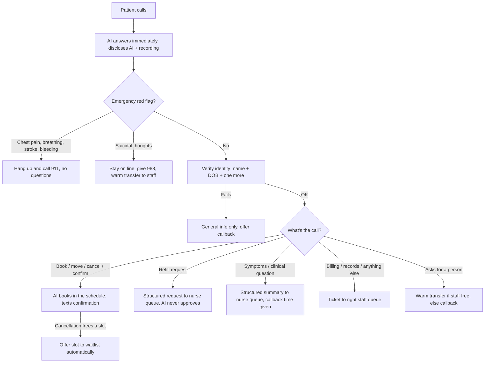

# Ravenswood Family Medicine · Discovery

> **Simulated client.** Ravenswood Family Medicine and its staff are fictional.
> Industry numbers, rules, and technical facts come from the public sources at
> the bottom. Vendor marketing claims are labeled as such. All patient data in
> this project is synthetic. No real health information is used anywhere.

---

## 1. What the client asked for, and what they actually need

**What they asked for (simulated):** "We want an AI receptionist. Our phones are
a disaster."

**What discovery found:** the phones aren't the problem. They're where the problem
shows up. The real problems are:

1. **Phone and front desk compete for the same two people.** At 8am, the front
   desk is checking in patients in person *and* answering the morning call surge.
   Calls lose every time.
2. **Most calls are predictable and structured** (book, move, cancel, confirm,
   hours). Staff time goes to them because there's no other way in, not because
   they need a person.
3. **Cancelled slots go unused.** About 1 in 5 primary care appointments is a
   no-show, and a slot freed by a late cancellation usually goes empty because
   nobody has time to call the waitlist.
4. **Clinical calls land in the wrong place.** Sick calls and refill questions
   hit the front desk, get written down by hand, and are passed to the nurse
   with key details missing.

So the job isn't "replace the receptionist." It's **redesign how phone work flows
through the clinic**: automate the structured calls end to end, hand everything
clinical to the right person *with a clean summary*, and use freed time and
freed slots better.

---

## 2. The client

**Ravenswood Family Medicine**, a primary care practice on Chicago's North Side
- **4 physicians + 1 nurse practitioner**
- **2 front desk staff** (Rosa, Kevin): check-in, check-out, phones, insurance
- **1 triage nurse** (Angela, RN): sick calls, refill requests, test result questions
- **Practice manager** (Michelle): runs operations, owns the budget and the metrics
- **Scheduling system:** a common practice management/EHR product (see §6)

**Rough phone volume** (industry averages applied to 5 clinicians):
- ~53 calls per physician per day → **about 250 calls a day**
- **~38% arrive in the first and last hour** the office is open
- **~20–25% go unanswered** at a typical practice (voicemail, hang up on hold,
  disconnected); solo and small practices tend to miss more

---

## 3. Who's involved and what each wants

| Person | Wants | Afraid of |
|---|---|---|
| **Patient** | Get booked fast, without hold music or calling back three times | Being stuck with a robot that can't help; privacy |
| **Caregiver** (parent, adult child of an elderly patient) | To handle things for someone else | Being refused because they're not the patient |
| **Front desk** (Rosa, Kevin) | Fewer phone interruptions while checking people in | **Being replaced**; cleaning up the AI's mistakes |
| **Triage nurse** (Angela) | Clinical calls that arrive with the right details | Getting flooded with low-quality messages |
| **Physicians** | Full schedules, fewer no-shows | An AI giving medical advice in their name |
| **Practice manager** (Michelle) | Answered calls, filled slots, measurable results | Cost, HIPAA risk, staff pushback |

**The adoption risk is the front desk, not the technology.** If Rosa and Kevin see
this as replacing them, they'll work around it, and they'll be the first to
report every mistake. The rollout plan has to make them its owners: they review
the AI's handoffs, they can flag errors, and the pitch is "no more phones while
you're checking people in," not "fewer staff."

---

## 4. Rules we can't negotiate

### HIPAA: verify identity before discussing anything
- Before sharing *any* patient information (including "you have an appointment
  Tuesday"), confirm the caller's identity: **full name plus at least two more
  identifiers** (e.g. date of birth, address, phone number on file).
- **Caller ID alone is not enough.** Families share phones; a spouse calling from
  the home line is not the patient.
- **Caregivers:** a parent booking for a child or an adult child for a parent
  needs the patient's identifiers *and* a record that they're authorized to act
  for the patient.

**What this means for us:** identity verification is a step in the workflow
that code enforces. The model collects the identifiers; code checks them
against the record and unlocks patient details only on a match.

### HIPAA: every vendor that touches patient data needs a BAA
- A **Business Associate Agreement (BAA)** is a contract required before a vendor
  handles patient information. A voice agent touches it at every layer: phone
  carrier, speech-to-text, the LLM, text-to-speech, storage.
- Plus encryption in transit and at rest, access controls, audit logs, and
  storing only what's needed ("minimum necessary").

**What this means for us:** we use only synthetic patients. A real deployment
would need signed BAAs across the whole chain *before* go-live. That goes in the
rollout plan as a gate, not a footnote.

### Illinois: all-party consent to record
Same as any Illinois deployment: the AI disclosure and recording notice is played
by code at the start of every call.

### Emergencies: no questions, no assessment
- Guidance for non-clinical staff is consistent: if a caller describes chest
  pain, trouble breathing, stroke signs (face drooping, arm weakness, slurred
  speech), severe bleeding, or loss of consciousness, **tell them to hang up and
  call 911. Don't ask follow-up questions.**
- **Suicidal thoughts are different:** the guidance is *not* to disconnect.
  Give the 988 Suicide & Crisis Lifeline, get a staff member involved, and if the
  danger is immediate, have someone call 911 while the caller stays on the line.

**What this means for us:** two different emergency paths. For physical red
flags, the AI gives the 911 instruction immediately. For suicidal thoughts,
"tell them to hang up" is the wrong answer: the AI must stay with the caller,
give 988, and bring in a person right away. This is a decision Michelle and the
clinicians must sign off on (D18).

### Never give medical advice
The AI never says whether a symptom is serious, never suggests medication or
dosage, never interprets test results. Anything clinical goes to the nurse.

---

## 5. How phone work flows today

**Where it breaks:**
- **Hold and voicemail** during the surge: patients give up or go elsewhere.
- **Phone tag** on voicemail callbacks.
- **Handoffs to the nurse** lose information (no date of birth, no symptom
  duration, no callback number).
- **Cancelled slots stay empty** because nobody has time to work the waitlist.

---

## 6. Integration reality

- **FHIR** is the healthcare standard for sharing data. It has standard resources
  for scheduling: **Schedule** (a clinician's calendar), **Slot** (a bookable
  time), **Appointment**, and **Patient**. Public test servers exist (HAPI FHIR).
- **But the standard often isn't how booking actually works.** Reading data
  through FHIR is widely supported. *Writing* (actually booking) is not:
  - athenahealth's FHIR API supports almost no writes; booking goes through its
    own separate API.
  - Epic's scheduling often uses older, non-FHIR endpoints, and write access
    needs extra review and approval at each hospital or clinic.
  - What's enabled varies **per customer**, even on the same EHR.

**What this means for us:** a real deployment's first technical risk is "can we
even write appointments, and through which API?" That's a day-1 discovery
question, not a build detail. For this project, our mock system uses **FHIR's
data shapes** (Patient, Slot, Appointment), with the write path behind the
adapter, so swapping in a vendor's own booking API changes only the adapter.

---

## 7. Proposed new workflow

**What the AI does end to end:** booking, rescheduling, cancelling, confirming,
general questions, and offering freed slots to the waitlist.

**What stays with people, on purpose:**
| Stays human | Why |
|---|---|
| Any clinical judgment (is this serious? should I come in?) | Medical advice; liability; nurses are trained for this |
| Approving refills | Requires a clinician |
| Test results | Must be explained by a clinician |
| Billing disputes | Judgment and empathy; money |
| Suicidal callers | Must reach a person; AI's job is 988 and the warm handoff |

**The handoff is the product.** Every handoff lands in a staff queue with a
structured summary: who (verified or not), what, how long, callback number,
urgency the patient described, and the transcript. The measure of success is
**Angela never has to call someone back just to ask what they called about.**

---

## 8. Success metrics (draft for D6)

| Metric | Why it matters |
|---|---|
| **Red-flag calls handled correctly** (target: 100%) | Safety. Non-negotiable |
| **Disclosures to unverified callers** (target: 0) | HIPAA |
| Calls answered within 30 seconds | The original pain |
| Calls fully handled by the AI (booking, cancel, confirm, questions) | Front desk time freed |
| Handoffs that needed no clarifying callback | Handoff quality |
| Cancelled slots refilled from the waitlist | New revenue, fewer empty slots |
| Staff-reported AI errors per week | Trust and adoption |

---

## 9. What we've learned so far (draft findings)

1. **The ask ("AI receptionist") isn't the need.** The need is separating phone
   work from in-person work, and fixing handoffs. Automation is the means.
2. **The handoff matters more than the automation.** A bad handoff moves the
   work to the nurse and adds a callback. A good one saves everyone a step.
3. **Identity is a workflow step, not a question.** Caller ID isn't identity;
   shared family phones and caregivers make this harder than it looks.
4. **Two emergencies, two opposite instructions.** "Hang up and call 911" is right
   for chest pain and wrong for a suicidal caller.
5. **The standard exists; the write path often doesn't.** FHIR makes reading easy.
   Booking still runs through each vendor's own API, enabled per clinic.
6. **The biggest win may not be answering calls.** Refilling cancelled slots
   from a waitlist is revenue the clinic is currently losing.

---

## 10. Assumptions (what we couldn't verify)

| # | Assumption | Why it matters | How I'd check on day 1 |
|---|---|---|---|
| H1 | The clinic's EHR allows booking through an API | Without it, the AI can only take requests, not book | Ask the EHR vendor / IT; test in their sandbox |
| H2 | ~20–25% of calls are missed today | Sets the baseline and the ROI | Pull phone system reports for 4 weeks |
| H3 | Scheduling-type calls are ~40%+ of volume | Decides how much the AI can fully handle | Label a week of call logs by type |
| H4 | Name + DOB + phone on file is acceptable verification | The clinic's privacy officer decides this | Review their existing phone verification policy |
| H5 | The clinic keeps a usable waitlist | Slot backfill depends on it | Ask the front desk how they track it today |
| H6 | Front desk will accept and own the AI handoff queue | Adoption | Shadow them for a morning; involve them in design |
| H7 | Caregiver authorizations are recorded in the EHR | Decides if the AI can serve caregivers | Check where proxy access is documented |
| H8 | All vendors in the voice stack will sign BAAs | Hard gate for go-live | Confirm with each vendor before building on them |

---

## 11. What I'd ask Michelle in a real kickoff

1. Walk me through yesterday's 8–9am. Who was answering phones, and what else were they doing?
2. Which calls do you *never* want an AI to handle?
3. How do refill requests and sick calls reach Angela today? What's usually missing?
4. What happens to a cancelled 10am slot at 9:15am?
5. Which EHR and phone system do you use, and who's our contact at each?
6. Who has to approve this: you, the physicians, a privacy officer?
7. How will Rosa and Kevin hear about this project, and from whom?

---

## Sources

- MGMA, [Enhancing patient access through phone system improvements](https://www.mgma.com/articles/enhancing-patient-access-by-empowering-front-desk-staff-through-phone-system-improvements)
- AgentZap, [Medical practice phone statistics](https://agentzap.ai/blog/medical-practice-phone-statistics) (vendor; 53 calls/physician/day, 38% in first/last hour)
- Staffingly, [Why your call abandonment rate sits at 20%](https://staffingly.com/insights/pain-points-solutions/why-is-my-clinics-call-abandonment-rate-20-percent/) (vendor)
- OhMD, [7 ways to reduce patient call volume](https://www.ohmd.com/reduce-patient-call-volume) (vendor; call-type mix)
- ACP, [The front office bottleneck: schedules, phones and refills](https://immattersacp.org/archives/2008/03/one.htm)
- Clearwave, [Average no-show rate in primary care](https://www.clearwaveinc.com/blog/the-average-no-show-rate-in-primary-care-and-how-to-reduce-it/) (vendor; ~19%)
- HIPAA Journal, [Are phone calls HIPAA compliant?](https://www.hipaajournal.com/are-phone-calls-hipaa-compliant/)
- Accountable, [HIPAA compliance in patient phone conversations](https://www.accountablehq.com/post/ensuring-hipaa-compliance-in-patient-phone-conversations-a-detailed-guide)
- Level AI, [HIPAA-compliant AI voice agents: requirements](https://thelevel.ai/blog/hipaa-compliant-ai-voice-agents) (vendor; BAA chain)
- TriageLogic, [Adult chest pain office-hours triage protocol (PDF)](https://triagelogic.com/wp-content/uploads/2018/03/OH-Adult-Chest-Pain.pdf)
- American Nurse, [Telephone triage and recognition of stroke symptoms](https://www.myamericannurse.com/recognizing-stroke-symptoms-via-telephone-triage/)
- UW AIMS Center, [Developing protocols for suicide prevention in primary care (PDF)](https://aims.uw.edu/wordpress/wp-content/uploads/2023/06/Developing-Protocols-for-Suicide-Prevention-in-Primary-Care_020921-Final_1.pdf)
- Illinois DHS, [988 Suicide & Crisis Lifeline](https://www.dhs.state.il.us/page.aspx?item=145089)
- HL7, [FHIR R4 Slot](https://hl7.org/fhir/R4/slot.html) · [Schedule](http://hl7.org/fhir/schedule.html) · [HAPI FHIR test server](https://hapi.fhir.org/)
- Nirmitee, [EHR integration API comparison: Epic, Oracle, athena](https://nirmitee.io/blog/ehr-integration-api-comparison-epic-oracle-athenahealth-eclinicalworks/)
- Mindbowser, [Epic scheduling APIs](https://www.mindbowser.com/epic-scheduling-api-guide/)
- Healthcare Data substack, [Real-time scheduling is the hardest interoperability problem](https://healthcaredata.substack.com/p/real-time-scheduling-is-the-hardest)
